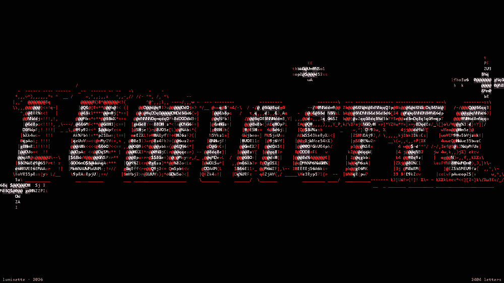

  

<h1 align="center">✧ Baby Aisha Maritza Virginia ✧</h1>

<b>Luminette</b> · Creative Technologist & Digital Alchemist · Jakarta, Indonesia

  Combining design, technology, and storytelling to craft immersive digital experiences. 
  I build communities, develop custom tools, and create content that bridges creativity and innovation.

  
  
  
  

 

## ✧ What I'm building

### 1. Aether: a virtual office run by an AI
> *Dream. Build. Automate.*

A low-poly, isometric 3D space station that works as a virtual office. Visitors are greeted by **Aether**, a formless "Jarvis" presence (voice + subtitles) that oversees every AI employee, makes the small decisions itself, writes reports, and keeps the finances in view.
- Central hub + 4 divisions: Observatory, Game Studio, Digital Creative Production, AI Automation
- ~20 themed rooms, 14 simulated AI employees, and an activity feed with approvals and a finance view
- Status: working prototype (sample data, backend next). Built with three.js, single-file, no build step.

### 2. [Backstage Prodigy](https://backstageprodigy.com)
Creative tech studio that helps Indonesian SMEs and underrepresented creators ship branding, websites, apps, and authentic digital experiences.

### 3. Game Studio
Cozy, small-scale games for a global audience, starting on Roblox.

### 4. Lyra
A game-based learning platform for **math** and **English**. Reasoning-first, gamified, and built for Indonesian learners.

 

## ✧ Experience

- **R&D Lead**, AIAVATAR Indonesia (Dec 2025 – Jun 2026): solo applied-AI research, internal tooling (KBMS), AI workshops and OKRs
- **Product Manager**, AIAVATAR Indonesia (Dec 2024 – Dec 2025): took the AIAVATAR mobile app from concept to launch
- **Community Manager**, BlockchainWorks, SHINTA VR, and UNPAS (2020 – 2023): Web3 and tech communities, content, custom Discord bots

 

## ✧ Skills

- **Design:** UI/UX, Figma prototyping, branding, layout, visual communication, creative direction
- **Data & AI:** Python, TensorFlow, machine learning, deep learning, NLP, data visualization, statistics
- **Automation & product:** n8n, product management, OKRs, knowledge systems
- **Web:** Junior Web Developer (BNSP), SQL (Oracle Academy)
- **Community & marketing:** community management, content, video production, website optimization
- **Languages:** Indonesian, English (fluent)

 

## ✧ Education

- **B.CS in Information Technology**, Mercu Buana University · GPA 3.92/4.0, Cum Laude, Outstanding Graduate (2020 – 2024)
- **Bangkit Academy 2023**, Machine Learning path (Google, GoTo, Traveloka) · capstone: Jejak.nesia
- **Fresh Graduate Academy Digital Talent Scholarship**, Machine Learning (Kominfo, Digitalent, IBM, Dicoding) · 162 hours
- **Associate Data Scientist** microcredential (Kemdikbudristek, 2021)

 

## ✧ Activity

  

